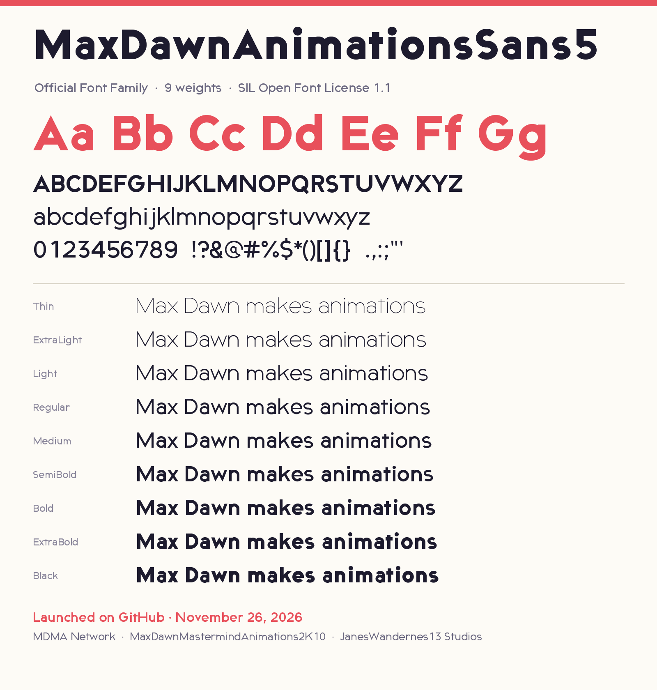

# MaxDawnAnimationsSans5

**MaxDawnAnimationsSans5** is a clean, friendly sans-serif font family designed for animation titles, motion graphics, video captions, posters, and everyday digital design.



## Made For the New Generation

MaxDawnAnimationsSans5 is created for the new generation of animation makers, with a look that fits:

- **GoAnimate** style videos
- **Vyond** style videos
- **Wrapper Offline** projects
- **Flash** themes

## Features

- Smooth, rounded-friendly letterforms that read well on screen and in motion
- Multiple weights and styles (Regular, Bold, Italic, Bold Italic)
- Wide language support for Latin characters
- Available in TTF, OTF, and WOFF2 formats
- Free and open source under the SIL Open Font License 1.1

## Launch Dates

| Platform | Date | Status |
|----------|------|--------|
| GitHub | Thursday, November 26, 2026 | Launched |
| Google Site | Saturday, November 28, 2026 | Coming soon |
| Google Drive | Sunday, November 29, 2026 | Coming soon |
| Mega.nz | Tuesday, December 1, 2026 | Coming soon |

## Download

Get the latest version from the [Releases page](../../releases/latest) and download `MaxDawnAnimationsSans5-v1.0.zip`.

## Installation

**Windows**
1. Unzip the download.
2. Right-click the font files and choose **Install** (or **Install for all users**).

**macOS**
1. Unzip the download.
2. Double-click a font file and click **Install Font** in Font Book.

**Linux**
1. Copy the font files into `~/.local/share/fonts/`.
2. Run `fc-cache -f -v`.

## Use on the Web

Copy the WOFF2 files to your project, then add this to your CSS:

```css
@font-face {
  font-family: "MaxDawnAnimationsSans5";
  src: url("fonts/webfonts/MaxDawnAnimationsSans5-Regular.woff2") format("woff2");
  font-weight: 400;
  font-style: normal;
  font-display: swap;
}

@font-face {
  font-family: "MaxDawnAnimationsSans5";
  src: url("fonts/webfonts/MaxDawnAnimationsSans5-Bold.woff2") format("woff2");
  font-weight: 700;
  font-style: normal;
  font-display: swap;
}

body {
  font-family: "MaxDawnAnimationsSans5", sans-serif;
}
```

## Repository Structure

```
MaxDawnAnimationsSans5/
├── fonts/
│   ├── ttf/
│   ├── otf/
│   └── webfonts/
├── sources/
├── docs/
├── OFL.txt
└── README.md
```

## Styles Included

| Style | Weight |
|-------|--------|
| Regular | 400 |
| Italic | 400 |
| Bold | 700 |
| Bold Italic | 700 |

## Contributing

Bug reports and suggestions are welcome! Please open an [issue](../../issues) to report missing glyphs, spacing problems, or feature requests.

## License

Copyright © 2026 MDMA Network, MaxDawnMastermindAnimations2K10 Official YouTube Channel, and JanesWandernes13 Studios. All rights reserved where not covered by the license below.

This font is licensed under the [SIL Open Font License, Version 1.1](OFL.txt). You may use it freely for personal and commercial projects, but you may not sell the font by itself.

---

Created by **MDMA Network**, the **MaxDawnMastermindAnimations2K10 Official YouTube Channel**, and **JanesWandernes13 Studios**. If you use this font in a project, we'd love to see it!
